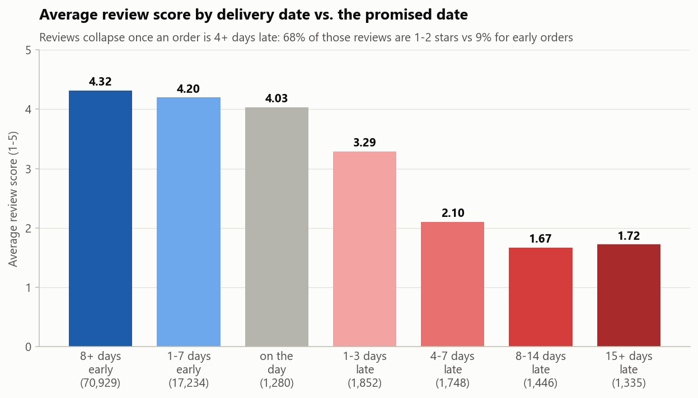
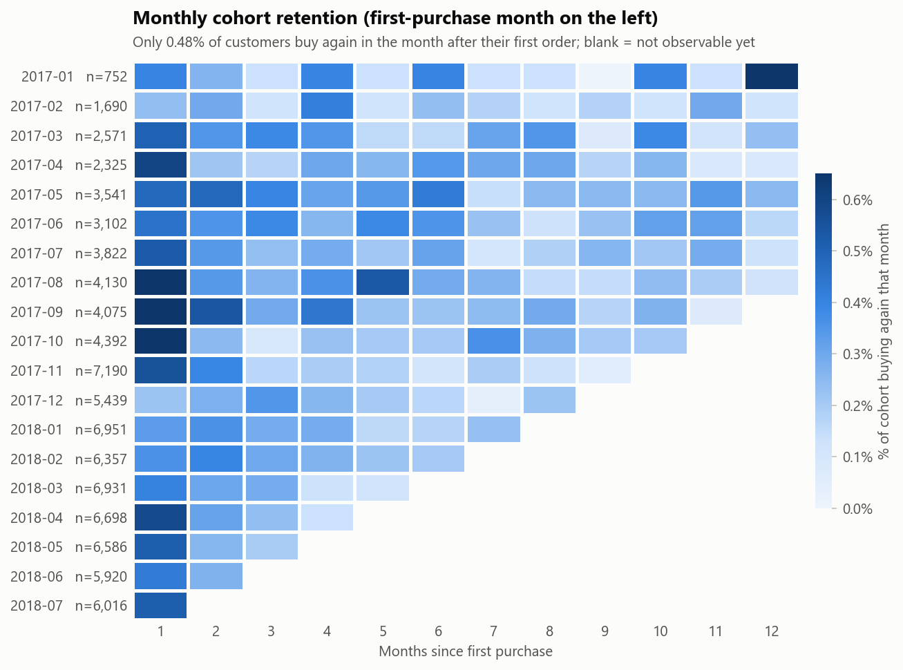
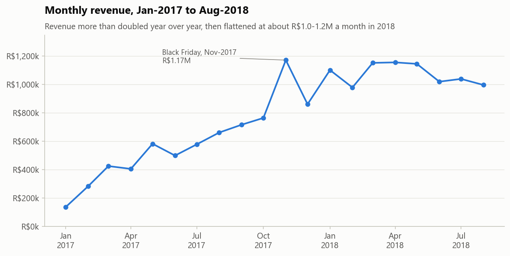
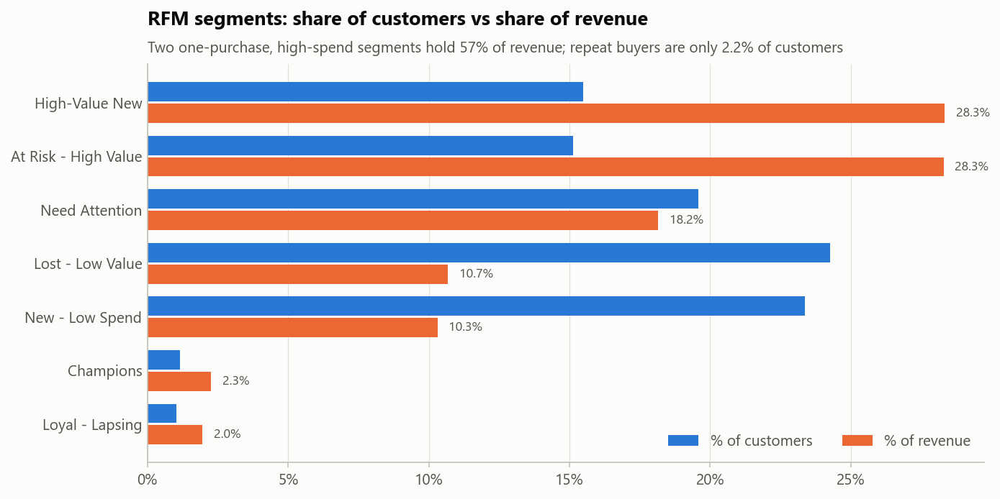
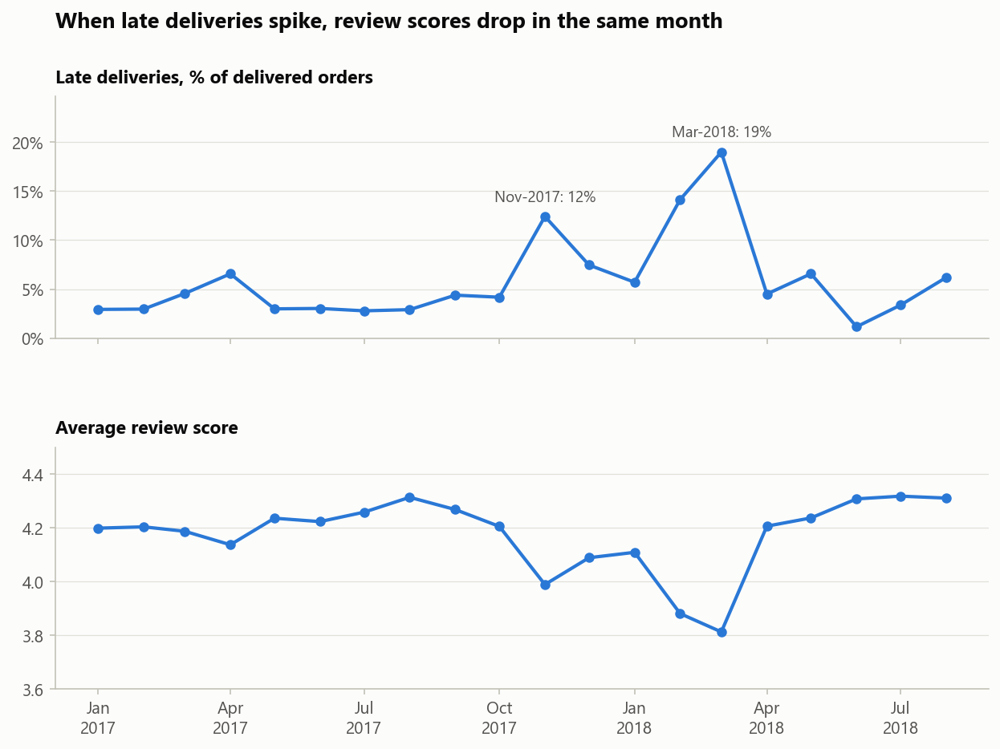
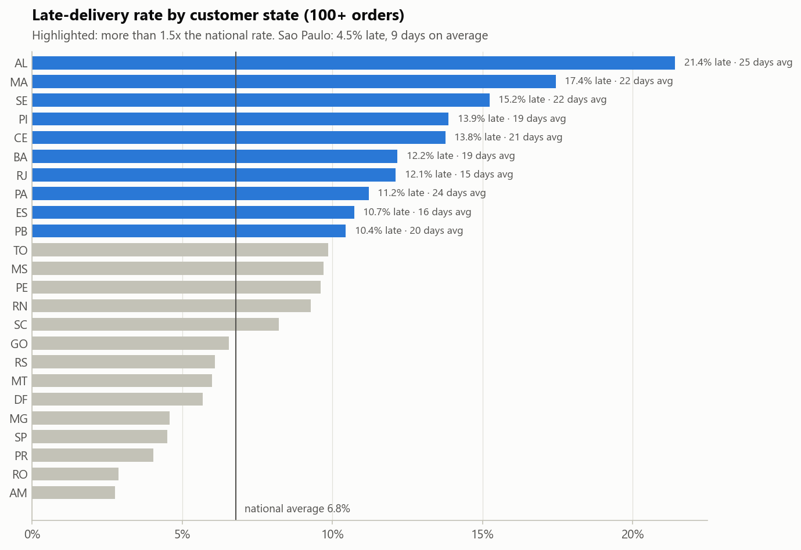
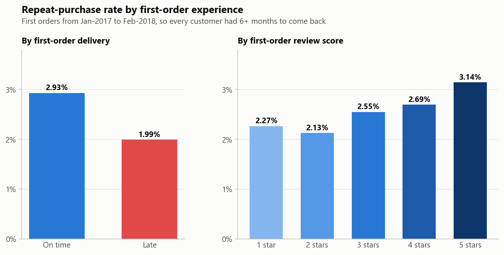
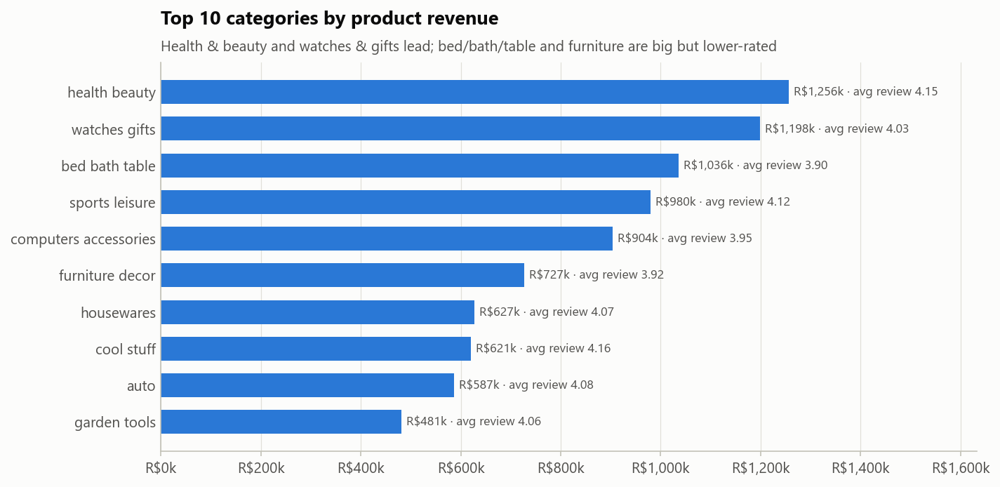

# Olist E-commerce: Customer Retention & Delivery Experience Analysis
🔗 **[View the live dashboard](https://tanush-00.github.io/olist-retention-analysis/dashboard/olist_dashboard.html)**

**Why don't customers come back, and how much does late delivery hurt the business?**

An end-to-end analysis of ~100k orders from Olist, a Brazilian online marketplace. It uses **SQL** (data modelling, cohort analysis, RFM segmentation, window functions), **Python** (pandas, matplotlib, statistical testing) and an **interactive dashboard** (HTML + Power BI guide), and ends with business recommendations sized in money.

| Item | Details |
|---|---|
| **Data** | [Olist Brazilian E-commerce dataset](https://www.kaggle.com/datasets/olistbr/brazilian-ecommerce): 9 relational tables, 99,441 orders, Sep-2016 to Oct-2018 |
| **Tools** | SQL (SQLite) · Python (pandas, NumPy, matplotlib) · Jupyter · Chart.js dashboard · Power BI |
| **Skills shown** | Data cleaning & quality audit · relational joins · CTEs & window functions · cohort retention · RFM segmentation · hypothesis testing · data storytelling |

---

## Key findings

| | Finding | Number |
|---|---|---|
| 1 | **Customers buy once and leave** | **97.8%** of customers never bought again; only **0.48%** return in the month after their first order |
| 2 | **Repeat customers are worth 2x** | Lifetime spend **R$321** vs **R$162** for one-time buyers |
| 3 | **Late delivery destroys reviews** | Late orders average **2.27★ vs 4.29★**; **62%** of their reviews are 1–2 stars (vs 9%) |
| 4 | **A bad first order may cost repeat business** | Repeat rate **1.99%** after a late first order vs **2.93%** on time (-32%, p = 0.001). Suggestive, not conclusive: with equal follow-up time the gap is **-21% (p = 0.08)**, see [Robustness check](#robustness-check) |
| 5 | **Growth has stalled** | Jan–Aug revenue **+140%** YoY, but flat at ~R$1.0–1.2M/month through 2018 |
| 6 | **Logistics break at peaks and far from São Paulo** | Late rate hit **19%** in Mar-2018; Alagoas waits **25 days** (21% late) vs São Paulo **9 days** (4.5%) |
| 7 | **A minority of sellers cause most delays** | The 30% of sellers with the worst late rate cause **54%** of late orders; the top 10% of sellers bring **67.5%** of revenue |





<details>
<summary>More charts</summary>








</details>

## Recommendations

1. **Second-purchase program.** 55% of repeat purchases happen within 90 days, so send a post-delivery offer on days 7–30 to the **High-Value New** segment (14.7k customers, avg R$303). *Each +1 pp of repeat rate ≈ +R$150k revenue.*
2. **Win-back campaign** for **At Risk - High Value** customers (14.4k customers, avg R$310, inactive for 9+ months, 13 months on average).
3. **Proactive delay alerts** with a small goodwill voucher when an order is predicted to be late. Reviews collapse once an order is 4+ days late (68% negative).
4. **Peak capacity planning** with carriers and sellers before Black Friday and Feb–Mar.
5. **Seller scorecard with SLA targets.** Focusing on the worst 30% of sellers addresses over half of all late deliveries.
6. **Regional logistics for the North-East** (regional carriers or hubs, plus region-specific delivery estimates).
7. **A/B test shorter, accurate delivery estimates.** Olist promises 24 days on average but delivers in 12.6. Padded estimates may cost conversions.

> **Impact, honestly sized:** halving late deliveries would avoid ~1,700 one- and two-star reviews but win back only about 14–31 repeat customers, possibly none (see the robustness check below). Delivery is a *hygiene factor*. Retention needs active marketing (recommendations 1–2).

## Robustness check

Finding 4 compares customers who *ever* bought again. That favours old cohorts: a customer whose first order was in Jan-2017 had up to 20 months to come back, one from Feb-2018 only about 7. Late deliveries were most common in exactly the months with the shortest follow-up (12% of first orders were late in Nov-2017 and 14% in Feb-2018, against 3–8% in the other months). On average the late group therefore had 9.8 months to come back and the on-time group 11.4, so part of the gap could be a follow-up-time effect, not a delivery effect.

`scripts/robustness_check.py` repeats the comparison five ways and saves the result to `outputs/robustness/first_order_late_vs_repeat.csv`:

| | What changes | Repeat rate, late first order | Repeat rate, on time | Late vs on time | p-value |
|---|---|---|---|---|---|
| **A** | Original: first orders Jan-2017 to Feb-2018, "ever bought again" | 1.99% (n = 3,667) | 2.93% (n = 51,560) | -32% | 0.001 |
| **B** | Equal window: same customers, "bought again within 180 days" | 1.61% | 2.03% | -21% | 0.077 |
| **C** | Early cohorts only (Jan to Oct 2017), within 180 days | 1.81% (n = 1,108) | 2.18% (n = 28,602) | -17% | 0.40 |
| **D** | B compared inside each first-order month, then combined (Mantel-Haenszel) | | | odds ratio 0.81 (0.62–1.06) | 0.13 |
| **E** | B plus first-order month, customer state and order value (logistic regression) | | | odds ratio 0.83 (0.64–1.09) | 0.18 |

**Reading it honestly.** A late first order goes with a lower repeat rate in all five variants, but the result is statistically significant only in the original one. Once everyone gets the same time to come back, the gap shrinks to about 0.4 percentage points and its 95% interval (-0.85 to 0.00) reaches zero. That is not proof that late delivery is harmless. This sample is simply too small to tell: about 15,900 late-first-order customers would be needed to detect a gap of that size reliably (80% power), and the data has 3,667. So the finding is *suggestive, not proven*. Running proactive delay alerts with a voucher (recommendation 3) as an A/B test is the way to settle it.

## Approach

```
Raw CSVs (9 tables)
   │  scripts/load_data.py         → SQLite database with schema, keys and indexes
   ▼
SQL analysis (sql/02 → 08)          → data-quality audit, cleaned views, KPIs, cohorts,
   │  scripts/run_sql.py               RFM, delivery and seller analysis (CSV results)
   ▼
Robustness check                    → re-tests the delivery → repeat finding with equal
   │  scripts/robustness_check.py      follow-up time, stratification and a logistic model
   ▼
Python notebook                     → cross-checks SQL in pandas, charts, z-test,
   │  notebooks/olist_analysis.ipynb   what-if sizing, recommendations
   ▼
Dashboards                          → interactive HTML dashboard + Power BI star schema
      dashboard/
```

### Data-cleaning decisions (from `sql/02_data_quality.sql`)

| Issue found | Decision |
|---|---|
| `customer_id` is created per order: 2,997 people have several IDs | All customer metrics use `customer_unique_id` |
| 547 orders have more than one review | Keep the most recent review |
| 1,234 canceled / unavailable orders | Excluded from revenue, customer and delivery metrics |
| 823 customers placed 2+ orders on the **same day** (one basket split by seller) | "Repeat customer" = purchases on **2+ different days** |
| Sep–Dec 2016 and Sep–Oct 2018 have very few orders | Monthly trends use Jan-2017 to Aug-2018 |
| "Late" | Delivered on a later calendar day than the estimated date |

### SQL highlights

Cohort retention with CTEs and month arithmetic (`sql/05_customer_retention.sql`):

```sql
WITH first_month AS (
    SELECT customer_unique_id, cohort_month FROM v_customers
),
activity AS (
    SELECT DISTINCT o.customer_unique_id, f.cohort_month,
           (CAST(substr(o.purchase_month, 1, 4) AS INTEGER) * 12 + CAST(substr(o.purchase_month, 6, 2) AS INTEGER))
         - (CAST(substr(f.cohort_month, 1, 4) AS INTEGER) * 12 + CAST(substr(f.cohort_month, 6, 2) AS INTEGER)) AS month_number
    FROM v_orders o
    JOIN first_month f ON f.customer_unique_id = o.customer_unique_id
)
SELECT cohort_month, month_number, COUNT(*) AS active_customers
FROM activity
GROUP BY cohort_month, month_number;
```

Other techniques used: `ROW_NUMBER()` to de-duplicate reviews and pick each customer's first order · `LAG()` for month-over-month and year-over-year growth · `NTILE()` for RFM scores and seller deciles · `SUM() OVER ()` for shares of total and cumulative Pareto curves · views as a clean semantic layer.

## Project structure

```
olist-retention-analysis/
├── run_pipeline.py              # one command to rebuild everything
├── requirements.txt
├── LICENSE                      # MIT, covers the code (not the Olist data)
├── sql/
│   ├── 01_schema.sql            # tables, keys, indexes
│   ├── 02_data_quality.sql      # audit: nulls, duplicates, orphans, impossible dates
│   ├── 03_clean_views.sql       # v_orders, v_customers (cleaning rules live here)
│   ├── 04_business_kpis.sql     # KPIs, monthly trend, YoY, states, payments
│   ├── 05_customer_retention.sql# repeat rate, time to 2nd purchase, cohorts
│   ├── 06_rfm_segmentation.sql  # RFM scores and segments
│   ├── 07_delivery_reviews.sql  # delay vs reviews, first-order experience vs repeat
│   └── 08_sellers_products.sql  # categories, seller Pareto, seller scorecard
├── scripts/
│   ├── config.py                # paths and settings
│   ├── download_data.py         # step 0: get the dataset from Kaggle
│   ├── load_data.py             # step 1: CSV → SQLite
│   ├── run_sql.py               # step 2: run SQL files, save results to CSV
│   ├── robustness_check.py      # step 2b: stress-test the delivery → repeat finding
│   ├── export_powerbi.py        # step 3: star-schema CSVs for Power BI
│   └── build_dashboard.py       # step 4: build the HTML dashboard
├── notebooks/
│   └── olist_analysis.ipynb     # full analysis with charts and narrative
├── dashboard/
│   ├── olist_dashboard.html     # interactive dashboard (open in a browser)
│   ├── dashboard_template.html  # its source template
│   └── powerbi_guide.md         # model, DAX measures and page layout for Power BI
├── outputs/
│   ├── figures/                 # chart PNGs used in this README
│   ├── robustness/              # results of the robustness check (CSV)
│   └── sql_results/             # every SQL query result as CSV
├── docs/
│   └── interview_prep.md        # how to present this project
├── data/raw/                    # Kaggle CSVs (git-ignored, downloaded by the pipeline)
├── data/processed/              # Power BI tables (git-ignored, generated)
└── database/olist.db            # SQLite database (git-ignored, generated)
```

## How to run

```bash
pip install -r requirements.txt
python run_pipeline.py
```

The pipeline downloads the data, builds the database, runs all SQL, stress-tests finding 4, exports the Power BI tables, builds the dashboard and re-executes the notebook (~3–4 minutes). Then:
- open **`dashboard/olist_dashboard.html`** in a browser (needs internet for Chart.js), or
- open **`notebooks/olist_analysis.ipynb`** in Jupyter / VS Code, or
- build the Power BI report with **`dashboard/powerbi_guide.md`**.

If the automatic download fails, download the zip from Kaggle and unzip the 9 CSVs into `data/raw/`.

## Limitations & next steps

- Public sample of Olist data (2016–2018). It has no marketing, traffic, margin or cost data, so impact is sized in revenue, not profit.
- The delivery → repeat-purchase link is an **association**, and only **suggestive** in this data (see [Robustness check](#robustness-check)). Customers who receive late orders may differ in ways the data cannot show, so recommendations should be validated with A/B tests.
- Next: a churn / repurchase propensity model, NLP on the Portuguese review text to find *why* customers are unhappy, and delivery-time prediction to power the proactive delay alerts.

## Data and licence

The data is the public [Brazilian E-Commerce Public Dataset by Olist](https://www.kaggle.com/datasets/olistbr/brazilian-ecommerce) on Kaggle, which belongs to Olist and has its own terms (see the dataset page). This repository does not include the raw files; `scripts/download_data.py` fetches them. The aggregated tables in `outputs/` are derived from that data. The code in this repository is under the [MIT licence](LICENSE).
